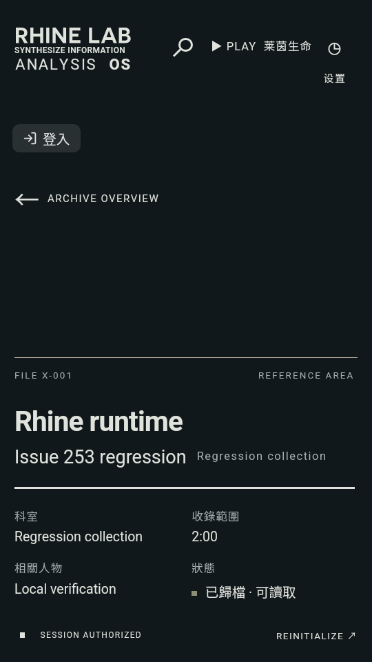
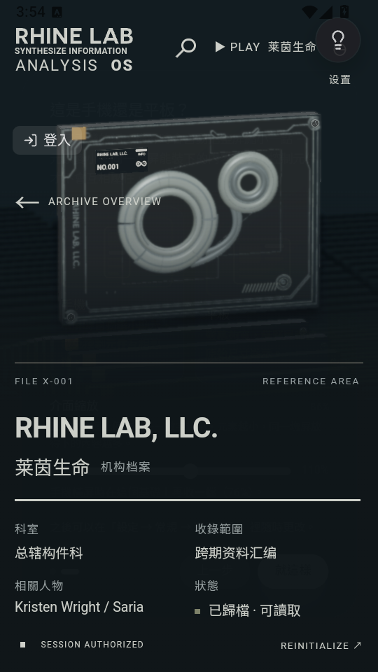

# Issue #253 验证记录

## 修改与范围

- Rhine 曲库 effect 仅依赖消费的集合输入；宿主 `filter` 生成新数组但元素/顺序相同不重读。集合对象替换仍会重建，不仅按 id 比较。
- 订阅收藏专辑资源快照，仅 data 变化重建；loading/error 状态沿用 data 时不重读。
- 所有宿主消息动作先校验当前 iframe 的 `event.source`，宿主搜索使用最新本地曲库与翻译。
- 保留原来的 10 集合、每集合 16 曲目上限，不改 iframe 构建产物、视觉布局、版本或生产 suite 默认。
- 为满足本地门禁，独立提交修复 #240 Windows npm launcher，以及先记录为 #254 的三个过期 suite 测试期望。

## 本地门禁

Windows 11 10.0.26200，Node 24.21.0；以 lockfile 执行 `npm ci --ignore-scripts` 安装精确依赖。

| 检查 | 结果 |
| --- | --- |
| 控件 / 体积 / 版本 / 源码密钥扫描 | 通过 |
| 前端 typecheck / sync-server tsc | 通过 |
| Rhine 与 home feed 定向测试 | 29/29 通过 |
| CI launcher 与 suite 定向测试 | 43/43 通过 |
| 完整单测 | 13106 passed、2 skipped、1 failed |
| `npm run build` 与产物密钥扫描 | 单独补跑通过 |
| Android `assembleRelease assembleDebug` | 通过 |

**不能称 `ci:local` 整条 exit 0**：唯一失败为 `test/unit/mod-system/modSignature.test.ts:139` 创建 symlink 时 Windows 返回 EPERM；未修改基线同样复现，属于 `AGENTS.md` 明示的 Windows 权限例外，以远端 Linux CI 为准。未删除、跳过或放宽该测试。因为命令链在此停止，后续 build 和产物扫描单独运行并通过。

## Android 实际运行验证

- 用户授权使用雷电模拟器；使用隔离克隆 `Folia-Issue253-Verify`，没有操作真实账号。
- 雷电 14.0.32.0 / Android 14 / 模拟机型 Honor BVL-AN00 / WebView Chrome 124.0.6367.82。
- `0.7.25.dev8`，versionCode **7025108**，完全沿用上游版本；release 使用本机 debug 测试证书签名，仅供隔离验收，不是官方发布签名。
- 从本分支执行 `npm run cap:sync:android`，构建并侧装 release APK，完成首启引导，Rhine 页面与 3D 档案正常显示，无 AndroidRuntime 致命异常。
- 同源码的 debug APK 用 CDP 在真实 Android WebView 挂载编译产物中的实际 RhineHome、实际 iframe，替换外部曲库端口和动作回调进行确定性断言；**不是在线账号播放/音频解码验收**。
- 初次挂载调用 1 次；同集合元素的新数组、交互状态/当前曲目/回调变化后仍 1 次；收藏资源 data 通知后读取歌单+专辑，总调用数变成 3。
- null / host 来源的设置、搜索、播放、入队消息均拒绝；当前 iframe 来源各接受 1 次。资源订阅数为 1。原始结果见 [native-result.json](./native-result.json)。
- 量化：CSS viewport 360×640；frame 为 (0,0,360,640)，宿主和 iframe 横向溢出均 0，frame 非零尺寸。17 个非零尺寸 iframe 控件。该次改动不调整布局。

### 截图（已实际打开检查）

编译组件确定性探针：

实际 release APK：

请人工确认「布局是否符合预期」。本次不自行合并，远端 CI 与人工审阅通过后再由维护者决定。
